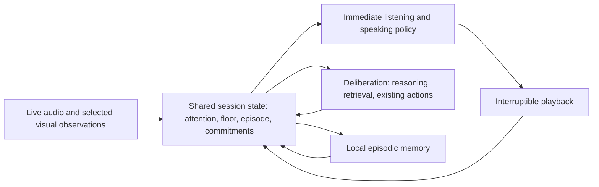

# NAILA through the “SOTA interesting project” lens

**My answer: make NAILA a local, situated conversation partner—one that keeps listening while speaking, shares attention to what is happening, and carries forward what the two of you have actually experienced and agreed.** The architectural leap is a persistent conversation state connecting audio, perception, memory and speech production. My proposed focus is one person, one room, one ongoing interaction. This synthesizes the speech-native direction of [Moshi](https://arxiv.org/html/2410.00037v2), contextual voice in [Sesame's work](https://www.sesame.com/journal/crossing-the-uncanny-valley-of-voice), and situated multimodal interaction in [Project Astra](https://deepmind.google/models/project-astra/); it is my recommendation, not an established claim that NAILA can already match those systems.

The original report emphasized rigor more than the operator intended. This replacement answers (1)–(4) around **capability depth and architectural ideas**. External evidence appears in (4) to distinguish a real capability from an attractive demo.

## Evidence and the oracles behind this answer

The repo remains at `2081d476c071380b5932aab9f9defad283c22a4e`, verified with `git rev-parse HEAD`. I reread the relevant speech, orchestration, memory, prompt and vision paths and read additional primary sources below. No code changes, installations, model runs or project checks were performed. Only the requested report and status output are written.

“Top oracles” is my selection of relevant builders and researchers, not a verified ranking. Published capabilities below belong to their systems; proposed NAILA capabilities are labeled as proposals.

| Primary material read | Fact established / architectural lesson |
|---|---|
| **Kyutai: Défossez, Mazaré and collaborators**, [Moshi paper](https://arxiv.org/html/2410.00037v2), [implementation](https://github.com/kyutai-labs/moshi) | Parallel user/assistant audio streams make listening and speaking part of the model's ongoing operation. Text can accompany speech without being its sole representation. The interesting lesson is preservation of conversational dynamics and acoustic information. |
| **NVIDIA: Roy, Raiman, Lee, Ene, Kirby, Kim, Kim, Catanzaro**, [PersonaPlex paper](https://research.nvidia.com/labs/adlr/files/personaplex/personaplex_preprint.pdf), [builder writeup](https://research.nvidia.com/labs/adlr/personaplex/) | Extends Moshi with text-based role conditioning and audio-based voice conditioning while retaining duplex interaction. Personality/role control and speech-native behavior can coexist; their integration is an architectural target worth studying. |
| **Sesame: Schalkwyk, Kumar, Lyth, Eskimez and collaborators**, [conversational voice writeup](https://www.sesame.com/journal/crossing-the-uncanny-valley-of-voice), [CSM implementation](https://github.com/SesameAILabs/csm), [2026 timing writeup](https://www.sesame.com/journal/turnbench) | Conversation history informs vocal delivery. Released CSM takes text/audio speaker segments; it is a speech generator, not a complete conversational intelligence. Sesame also distinguishes delivery from conversation structure. A pleasing voice alone does not supply listening behavior. |
| **Google DeepMind**, [Project Astra capability description](https://deepmind.google/models/project-astra/) | Describes context-aware dialogue, visual highlighting, multimodal memory and personalization in a research prototype. This supports situated interaction as a frontier direction; the page does not disclose enough architecture to reproduce Astra or prove its advertised reliability. |
| **Qwen team**, [Qwen2.5-Omni report](https://arxiv.org/html/2503.20215v1); **OpenBMB**, [MiniCPM-o 4.5 implementation docs](https://github.com/OpenBMB/MiniCPM-V/blob/main/docs/minicpm_o4dot5_en.md) | Qwen explicitly preserves audio/video temporal positions and separates text reasoning from speech generation. OpenBMB exposes streaming prefill/generation for duplex multimodal interaction. These show concrete streaming mechanisms beyond independent image captions and completed speech turns. |
| **Zhang, Dong, Lin, Madotto, Kumar, Damavandi, Chai, Moon**, [Proactive Assistant Dialogue Generation from Streaming Egocentric Videos](https://arxiv.org/html/2506.05904v1) | Models whether to speak or remain silent and carries task progress through iterative summaries. Its dialogue data are synthesized from annotated videos: useful research material, not direct evidence of successful household companionship. |
| **Park and collaborators**, [Generative Agents](https://arxiv.org/html/2304.03442v2); **Packer and collaborators**, [MemGPT](https://arxiv.org/html/2310.08560v2) | Generative Agents combines observations, retrieval, reflection and planning; MemGPT explicitly manages working and external memory under a bounded context. They motivate structured continuity. Simulated believability and retrieval are not evidence that inferred personal beliefs are true. |
| **Apple's model builders**, [2025 technical report](https://arxiv.org/html/2507.13575v3) | Co-designs on-device architecture, compression, adaptation and structured generation. My lesson is to make the local resource envelope an architectural constraint, with task-specific computation and bounded context. It does not imply a required migration to Apple's framework. |

## (1) What I judge a top practitioner would build here

### 1. Make speech an ongoing interaction, with acoustic context intact

**Repo fact.** NAILA's RPC buffers complete utterances and gives the orchestrator a transcription and confidence. That task payload does not carry the user's audio or prosody. Hub VAD suppresses silence, and its internal events are Start/Continue/End. [rpc/service.py:202](/Users/j/code/robo-naila/ai-server/rpc/service.py:202), [rpc/service.py:665](/Users/j/code/robo-naila/ai-server/rpc/service.py:665), [hub/src/vad.rs:107](/Users/j/code/robo-naila/hub/src/vad.rs:107), [hub/src/audio.rs:35](/Users/j/code/robo-naila/hub/src/audio.rs:35).

**My proposal.** Make the session—not the completed request—the primary unit of intelligence. Preserve a bounded, time-aligned audio context while NAILA speaks. Represent a user's continuation, acknowledgment, correction and attempted takeover as different possibilities. A pause should remain information; speech onset should not automatically mean “cancel everything.” This is a capability change: NAILA can follow “put it—actually, use the other one” while the interaction is unfolding. Moshi supplies the speech-native reference; PersonaPlex adds role/voice control to that direction. [Moshi](https://arxiv.org/html/2410.00037v2), [PersonaPlex](https://research.nvidia.com/labs/adlr/files/personaplex/personaplex_preprint.pdf).

I would **first explore a speech-native backend behind the existing hub**, so the architecture is informed by what continuous speech models can do. Moshi's official MLX path includes 4-bit local inference on macOS; it is a concrete exploration tool, not a promise of acceptable speed, personality or reasoning on this Mac. PersonaPlex is a controllability reference, with no verified deployment result here. [Moshi MLX](https://github.com/kyutai-labs/moshi#mlx-implementation-for-local-inference-on-macos), [PersonaPlex code](https://github.com/NVIDIA/personaplex).

A cascade remains a practical implementation option, but would need explicit acoustic context and interaction control. Attaching a speech-native model to the current utterance-only interface would discard much of the reason to use it. That is my architectural inference from the current payload and parallel-stream design. [rpc/service.py:665](/Users/j/code/robo-naila/ai-server/rpc/service.py:665), [Moshi architecture](https://arxiv.org/html/2410.00037v2).

### 2. Give it a shared situation, beginning with attention to one object

**Repo fact.** Vision currently analyzes a supplied image; the graph clears the image after analysis. The LLM receives a generated description and object counts. Visual queries use count/presence rules. [graphs/orchestration.py:73](/Users/j/code/robo-naila/ai-server/graphs/orchestration.py:73), [response_generator.py:184](/Users/j/code/robo-naila/ai-server/agents/response_generator.py:184), [vision.py:591](/Users/j/code/robo-naila/ai-server/services/vision.py:591).

**My proposal.** Start with one visible work surface and an explicit focus of attention: which object the user means, which observation supports it, what changed, and what is no longer visible. Let “that one,” “the one from before,” and “no, the other one” update a persistent referent. Ask when reference is ambiguous. A small observation history with object identity, crop/frame references and timestamps is enough to begin; a general 3D world simulator is unnecessary. This is my narrow translation of Astra's situated interaction and Qwen's temporal multimodal alignment. [Astra](https://deepmind.google/models/project-astra/), [Qwen2.5-Omni](https://arxiv.org/html/2503.20215v1).

Use the existing detector for inexpensive candidates/tracks, then a local image-language model on a relevant crop or short frame sequence when the question needs richer evidence. Model selection remains open. Crucially, keep the distinction between **currently observed**, **last seen**, **user said**, and **inferred**. This proposed state model addresses the current description/count bottleneck; it is not a capability YOLO alone supplies. [vision.py:469](/Users/j/code/robo-naila/ai-server/services/vision.py:469), [response_generator.py:195](/Users/j/code/robo-naila/ai-server/agents/response_generator.py:195).

### 3. Make personality a way of participating, with continuity across episodes

**Repo fact.** The system prompt specifies sass, curiosity, short answers and references to recent history. Persistent memory stores exchanges per device and recalls the most recent N. TTS receives text, voice and speed, with no conversational audio context in its public synthesis parameters. [prompts/system.txt:1](/Users/j/code/robo-naila/ai-server/prompts/system.txt:1), [memory/conversation.py:29](/Users/j/code/robo-naila/ai-server/memory/conversation.py:29), [memory/conversation.py:48](/Users/j/code/robo-naila/ai-server/memory/conversation.py:48), [services/tts.py:162](/Users/j/code/robo-naila/ai-server/services/tts.py:162).

**My proposal.** Make the same NAILA recognizable through timing, restraint, repair and vocal delivery: playful when invited, attentive when corrected, able to let a thought finish. Do not treat sass as the response to every situation. Context-conditioned speech is the relevant mechanism to investigate: Sesame's released API can condition on prior audio/text segments, while its builders explicitly caution that CSM does not itself model the full conversation structure. [CSM](https://github.com/SesameAILabs/csm), [Sesame technical discussion](https://www.sesame.com/journal/crossing-the-uncanny-valley-of-voice).

For continuity, I would distinguish:

- **Working situation:** current topic, referents, unresolved question, what NAILA was about to say.
- **Episodes:** what happened together, linked to source turns/observations and what was actually delivered.
- **Persistent beliefs and commitments:** explicitly expressed preferences, corrections, outstanding agreements, with provenance and the ability to revise or forget.

These are proposed data distinctions within the existing local store. MemGPT supplies a bounded working/external-memory pattern; Generative Agents supplies observation/reflection separation. My addition is to keep an inference revisable and traceable rather than silently promoting it to a fact about the person. [MemGPT](https://arxiv.org/html/2310.08560v2), [Generative Agents](https://arxiv.org/html/2304.03442v2). The current database already accepts metadata, so a separate memory service or vector database is not a prerequisite. [memory/conversation.py:29](/Users/j/code/robo-naila/ai-server/memory/conversation.py:29).

### 4. Separate immediate participation from slower thought, around one shared state

**Repo fact.** The graph runs sequentially from input through vision/context/action dispatch to response generation. Speech synthesis consumes completed sentences, with one-sentence lookahead before delivery. [graphs/orchestration.py:48](/Users/j/code/robo-naila/ai-server/graphs/orchestration.py:48), [response_generator.py:222](/Users/j/code/robo-naila/ai-server/agents/response_generator.py:222), [response_generator.py:250](/Users/j/code/robo-naila/ai-server/agents/response_generator.py:250).

**My proposed architecture:**

The live policy handles listening, yielding and short context-appropriate responses; deliberate computation produces grounded answer content. Both read the same versioned situation. If the user corrects the referent, a result computed for the old referent becomes obsolete. This is my synthesis, not an off-the-shelf combination demonstrated by one cited paper. Qwen's Thinker/Talker separation and Apple's task/compute co-design motivate the separation of responsibilities. [Qwen](https://arxiv.org/html/2503.20215v1), [Apple report](https://arxiv.org/html/2507.13575v3).

**Silence is a deliberate output.** A changed scene can update attention without forcing a spoken caption. After an explicit “watch this with me,” NAILA may offer one relevant intervention, then wait. ProAssist directly treats speaking versus remaining silent as a modeling decision and maintains task progress; that is the useful mechanism to borrow, rather than adding a general autonomous planner. [ProAssist §§5.2–5.3](https://arxiv.org/html/2506.05904v1).

Keep this on the existing device → hub → AI-server division. The repo documents a Pi 4 hub and M4 Air/16 GB AI host. Do not assume every omni model fits: OpenBMB's documented full-duplex Mac configuration requires M4 Max/24 GB. Native speech integration, memory injection into it and coherent handoff to a deliberative model remain engineering/research risks. [docs/PI_HUB_SETUP.md:3](/Users/j/code/robo-naila/docs/PI_HUB_SETUP.md:3), [MiniCPM-o deployment/limitations](https://github.com/OpenBMB/MiniCPM-V/blob/main/docs/minicpm_o4dot5_en.md).

**My priority:** prove continuous conversational participation first, then attach one shared visual referent and one revisable episode. These are successive depths of the same interaction. The existing hub and local memory are useful foundations; the current utterance payload and description-only visual context are the main boundaries to reconsider. [rpc/service.py:665](/Users/j/code/robo-naila/ai-server/rpc/service.py:665), [response_generator.py:184](/Users/j/code/robo-naila/ai-server/agents/response_generator.py:184).

## (2) The raw material they would start from

**My recommendation is lived interaction before its textual summaries.** The useful material is:

| Raw material | What it makes possible |
|---|---|
| Synchronized user and assistant audio, including pauses, overlap, corrections and recent vocal context | Learn/condition how to participate and deliver speech. Moshi uses parallel audio streams; CSM accepts conversational audio/text segments. [Moshi](https://arxiv.org/html/2410.00037v2), [CSM](https://github.com/SesameAILabs/csm). |
| Original frames/crops and short temporal sequences tied to utterances and object identities | Recover “this,” “before” and “changed,” before those distinctions are flattened into counts. [Qwen temporal alignment](https://arxiv.org/html/2503.20215v1), [current visual reduction](/Users/j/code/robo-naila/ai-server/agents/response_generator.py:195) |
| Actual observations, user corrections, agreements and source-linked episodes | Build a revisable working understanding from experience. Memory architecture references: [MemGPT](https://arxiv.org/html/2310.08560v2), [Generative Agents](https://arxiv.org/html/2304.03442v2). |
| Builder implementations, pretrained streaming codecs/models, and their inference contracts | Start from usable mechanisms: [Moshi/Mimi](https://github.com/kyutai-labs/moshi), [PersonaPlex](https://github.com/NVIDIA/personaplex), [CSM](https://github.com/SesameAILabs/csm), [MiniCPM-o streaming APIs](https://github.com/OpenBMB/MiniCPM-V/blob/main/docs/minicpm_o4dot5_en.md). These serve different roles and are not interchangeable complete assistants. |

For adaptation, my proposed training unit is a small coherent interaction: context → user signal → whether/how NAILA participates → correction/outcome. Include occasions to remain silent. Use consented examples of the intended companion behavior; synthetic dialogue can bootstrap examples but cannot establish what the operator wants a companion to be. PersonaPlex uses synthetic speech conversations and ProAssist uses synthesized dialogue; neither supplies NAILA's product judgment. [PersonaPlex paper](https://research.nvidia.com/labs/adlr/files/personaplex/personaplex_preprint.pdf), [ProAssist data construction](https://arxiv.org/html/2506.05904v1).

## (3) Specific methods and tools I would use

These are proposed implementation choices, not changes performed.

1. **Prototype the live speech substrate separately.** Use official Moshi MLX 4-bit inference on the existing Mac to learn the continuous interface; use PersonaPlex's role/voice design as the controllability reference. Retain the existing transport initially. Moshi's minimal client explicitly lacks AEC, so NAILA's microphone/speaker-reference processing remains necessary. [Moshi MLX README](https://github.com/kyutai-labs/moshi/blob/main/moshi_mlx/README.md), [device audio callback:79](/Users/j/code/robo-naila/devices/audio-client/audio_client/audio.py:79).
2. **Build a session controller with explicit state transitions.** Maintain a bounded audio ring, floor ownership, active referent, pending speech/content and response version. Accept new perception while generating; support yield, resume and correction. Preserve media timing across VAD suppression, or deliver the continuous context to the speech-native backend. This proposal changes the current utterance-centric contract. [rpc/service.py:202](/Users/j/code/robo-naila/ai-server/rpc/service.py:202), [hub/src/vad.rs:107](/Users/j/code/robo-naila/hub/src/vad.rs:107).
3. **Use incremental visual grounding.** Keep object tracks and source crops; invoke a local image-language model for a focused question or meaningful change. Store shared attention in the session rather than rebuilding it from a new caption each turn. MiniCPM-o provides actual streaming prefill/generate examples, but its documented hardware and output limitations require a separate feasibility decision. [MiniCPM-o docs](https://github.com/OpenBMB/MiniCPM-V/blob/main/docs/minicpm_o4dot5_en.md), [current vision path:73](/Users/j/code/robo-naila/ai-server/graphs/orchestration.py:73).
4. **Extend SQLite with episodes and revisable assertions.** Proposed records: source event, subject/referent, observation versus assertion/inference, validity period, supersedes link and commitment state. Retrieve by relevance plus recency; keep a compact working summary and fetch supporting episodes when needed. Consolidate after interaction pauses; keep consolidation off the live speaking path. This is an adaptation of [MemGPT](https://arxiv.org/html/2310.08560v2) and [Generative Agents](https://arxiv.org/html/2304.03442v2), using [the existing memory store](/Users/j/code/robo-naila/ai-server/memory/conversation.py:29).
5. **Represent conversational intent beyond response text.** Proposed speech plan: purpose, referent, certainty, emphasis and whether the utterance yields the floor. Use context-conditioned generation where the model supports it; do not assume existing Kokoro can infer all of that from text. CSM's segment API is one concrete experiment; it still requires a separate source of response text. [CSM API/FAQ](https://github.com/SesameAILabs/csm), [current TTS interface:162](/Users/j/code/robo-naila/ai-server/services/tts.py:162).

I would postpone bespoke training until the chosen runtime exposes the needed controls. A prompt cannot supply missing streaming state or acoustic inputs; a voice-model replacement cannot supply grounded memory by itself. These are architectural deductions from the current interfaces and the distinct roles of the cited systems, not experimentally established limits of every possible implementation. [NAILA state:6](/Users/j/code/robo-naila/ai-server/graphs/states.py:6), [CSM FAQ](https://github.com/SesameAILabs/csm).

## (4) What other than either of us would show this is right?

**Independent interaction with the real system, grounded in observable events.** My proposed capability proof is an unscripted desk conversation: a participant shows two objects, refers to one ambiguously, corrects NAILA mid-reply, moves an object out of view, changes a preference, leaves and returns. NAILA should clarify, follow the correction, distinguish last-seen from current evidence, and carry forward the corrected agreement. This is a proposed demonstration of the architecture above, not an existing repo behavior.

The external arbiters would be:

- **Independent participants and conversation researchers:** judge whether NAILA handles acknowledgment, interruption, continuation and repair appropriately in interactions they control. Sesame's work explicitly separates content, delivery and timing; that distinction helps inspect the experience without reducing it to one number. [Sesame timing writeup](https://www.sesame.com/journal/turnbench).
- **The scene and its recorded history:** an independently controlled object movement/correction provides a factual arbiter for what was seen, what changed and what remains unknown. A reviewer should inspect the source observation behind a remembered claim. This proposed verification directly targets the repo's image→description/count boundary. [vision.py:469](/Users/j/code/robo-naila/ai-server/services/vision.py:469), [response_generator.py:195](/Users/j/code/robo-naila/ai-server/agents/response_generator.py:195).
- **A second engineer running the artifact locally:** verifies the continuous audio path, state updates and episode continuity on the declared hardware, without a hidden operator or cloud intelligence. The repo's latest documented deployment check had no connected audio peer, so it does not yet establish this experience. [docs/PI_HUB_SETUP.md:14](/Users/j/code/robo-naila/docs/PI_HUB_SETUP.md:14).
- **Repeated voluntary use by intended users:** evidence that continuity and style remain useful after novelty. This is my proposed product criterion; it does not establish truth of beliefs or global technical superiority.

A demonstration can establish that NAILA has these capabilities. It cannot establish worldwide SOTA leadership. My claim is that this is a compelling frontier-aligned project thesis; superiority would require independent comparative evidence. The builder sources establish relevant directions, not that integrating their ideas guarantees the result.

## Operator-only questions

These decisions shape the design; no answer is assumed as authorization to implement it.

- Is NAILA primarily a conversational companion, or a companion during a shared physical activity? Which one-room experience should define its identity? The repo names conversation, vision and personality, without this narrower choice. [README.md:34](/Users/j/code/robo-naila/README.md:34).
- When may it initiate, backchannel or interrupt—and what counts as being addressed? ProAssist treats silence/speaking as a decision but cannot choose NAILA's social role. [ProAssist](https://arxiv.org/html/2506.05904v1).
- What personality boundaries and emotional interpretations are wanted? The prompt currently favors sass and engagement. Context-sensitive companionship requires an operator-defined target, not a universal “more human” setting. [system.txt:1](/Users/j/code/robo-naila/ai-server/prompts/system.txt:1).
- What experiences may be retained, inferred, corrected or forgotten, and who is the remembered person when a device is shared? Current memory is device-keyed; retention and sessions are deferred. [memory/conversation.py:1](/Users/j/code/robo-naila/ai-server/memory/conversation.py:1).
- Is the M4 Air/16 GB a firm ceiling? Is the project allowed to trade some factual reasoning breadth for a richer speech-native interaction? No studied source establishes that all the desired capabilities coexist on that host. [deployment hardware:8](/Users/j/code/robo-naila/docs/PI_HUB_SETUP.md:8), [MiniCPM-o requirements](https://github.com/OpenBMB/MiniCPM-V/blob/main/docs/minicpm_o4dot5_en.md).

**My proposed project thesis:** NAILA understands an unfolding conversation because it maintains a shared situation—acoustically, visually and episodically—and expresses its personality through how it participates. That is the depth I would pursue first. It is a design judgment informed by the sources above; deployment feasibility and the quality of that experience remain unverified.
